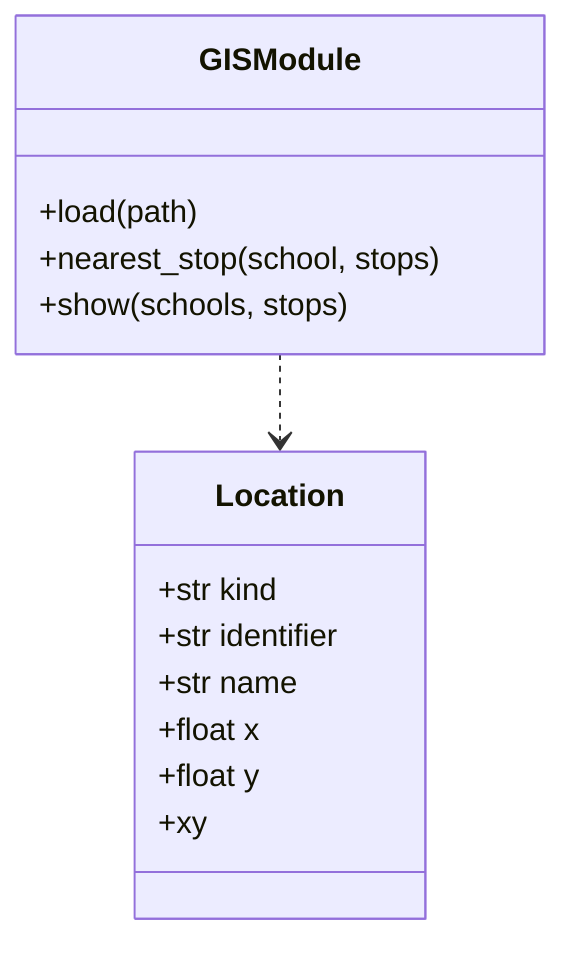
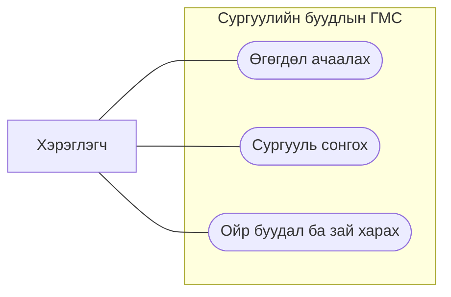
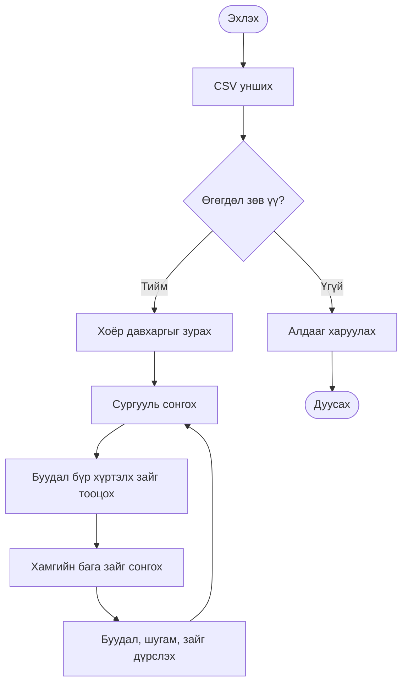

# Бие даалт 1 · Сургуульд хамгийн ойр автобусны буудал олох ГМС

Сэдвийн санал. Багийн гурван гишүүн сэдвээ хэлэлцэж, багшаар батлуулна.

## 1. Төслийн ерөнхий тодорхойлолт

Сургуулийн ойролцоох автобусны буудлуудыг нэг зурагт харуулж, сонгосон сургуулиас шулуун зайгаар хамгийн ойр буудлыг олно. Хэрэглэгч нь оюутан, сургуулийн ажилтан эсвэл тээврийн мэдээлэл судалж буй хүн. Прототип нь Windows компьютер дээр Python 3, Tkinter болон локал CSV файлаар ажиллана.

## 2. Өгөгдлийн загварчлал

Dataset → сургууль болон буудал гэсэн хоёр вектор цэгэн давхарга → Location объект. locations.csv нь зохиомол сургалтын өгөгдөл. Координат нь метрээр хэмжсэн локал хавтгайн X/Y бөгөөд бодит байршилтай холбоогүй.

| Талбар | Утга |
| --- | --- |
| kind | school эсвэл stop |
| id | Давхцахгүй таних дугаар |
| name | Дэлгэцийн нэр |
| x, y | Хавтгайн координат, метр |

CSV файлыг уншиж шалгаад kind талбараар бүлэглэнэ. Ирээдүйд цэгэн shapefile ашиглавал .shp геометрийг, .shx бичлэгийн индексийг, .dbf атрибутыг, .prj координатын системийг тодорхойлно.

## 3. Шаардлагын загварчлал

Функцийн шаардлага. CSV унших, хоёр давхарга зурах, сургууль сонгох, хамгийн ойр буудлыг шугамаар холбох, зай харуулах, буруу оролтод ойлгомжтой алдаа гаргах.

Функцийн бус шаардлага. Сүлжээ шаардахгүй ажиллах, ижил оролтод ижил үр дүн гаргах, координатын харьцааг хадгалах.

## 4. Алгоритм ба програмын загвар

app.py дотор Location, load, nearest_stop, show болон main багтана. load нь оролтыг шалгаж, объект үүсгэнэ. nearest_stop нь бүх буудлыг нэг удаа шалгаж, Евклидийн хамгийн бага зайг сонгоно. Тэнцвэл ID-аар эрэмбэлнэ. Нэг сургуулийн хайлт O(n). show нь ижил масштаб хэрэглэж, дэлгэцийн Y тэнхлэгийг эргүүлнэ.

## 5. Python прототип

PowerShell дээр python app.py гэж ажиллуулж, жагсаалтаас S1 болон S2-ыг ээлжлэн сонгоно. python -X utf8 app.py --no-gui нь үр дүнг терминалд хэвлэнэ.

| Туршилт | Хүлээгдсэн үр дүн |
| --- | --- |
| S1 | B1, 11.31 м |
| S2 | B3, 8.06 м |
| Давхардсан ID | CSV мөрийн дугаартай алдаа |
| Буудалгүй оролт | Хоёр давхарга шаардлагатай гэсэн алдаа |

Хамгаалалтын дэлгэцийн зурагт сонгосон сургууль, буудал, холбосон шугам, зайг хамтад нь харуулна. Энэ сэдвийн прототип нь вектор ойролцоо байдлын шинжилгээ хийдэг. Явган замын бодит зайг тооцох дараагийн хувилбарт замын граф болон хамгийн богино замын алгоритм шаардлагатай. Растер ба гадаргын шинжилгээ нь одоогийн хүрээнээс гадуур.

## 6. Дүгнэлт

Прототип нь өгөгдөл унших, дүрслэх, ойрын объект хайх үйлдлийг нэгтгэсэн. Зохиомол цэгүүд ба шулуун зай нь үзүүлэнгийн зориулалттай. Илүү олон буудалтай үед хязгаарын хайрцаг болон орон зайн индексээр нэр дэвшигчдийн тоог багасгаж болно. Том өгөгдлийг тусдаа урсгалаар унших боломжтой бөгөөд Tkinter шинэчлэлтийг үндсэн урсгалд хийнэ.

## 7. Хавсралт ба эх сурвалж

- app.py — эх код
- locations.csv — зохиомол цэгэн өгөгдөл
- Хичээлийн бие даалтын удирдамж
- Chaowei Yang, Introduction to GIS Programming and Fundamentals with Python and ArcGIS, 5 ба 8-р бүлэг
